<!-- Original recruiter-first GitHub profile, Midnight × Champagne Gold. -->

<picture>
  <source media="(prefers-reduced-motion: reduce)" srcset="./assets/currently-building-still.svg" />
  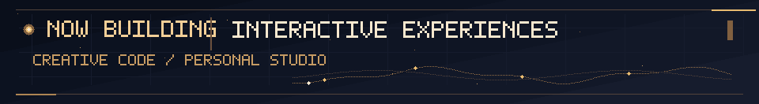
</picture>

 

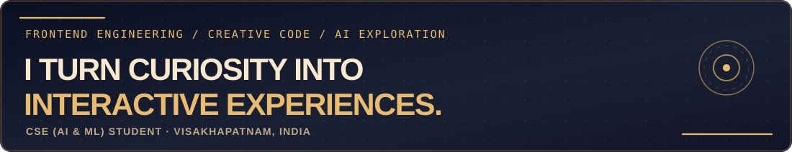

 

<a href="https://github.com/nikhilsaireddyi?tab=repositories">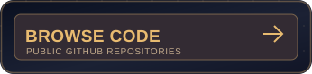</a>

 

---

## 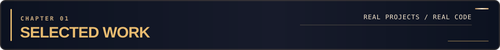

<table>
<tr>
<td width="50%" valign="top">
<a href="https://github.com/nikhilsaireddyi/ganesh-the-quest">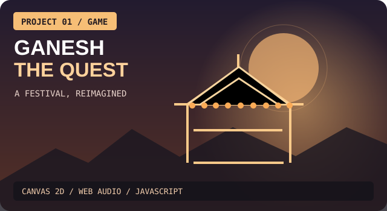</a>
<a href="https://github.com/nikhilsaireddyi/ganesh-the-quest">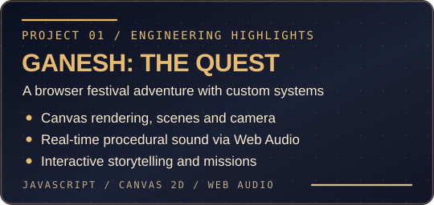</a>
</td>
<td width="50%" valign="top">

<a href="https://github.com/nikhilsaireddyi/Nikhil">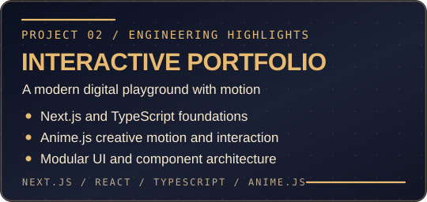</a>
</td>
</tr>
</table>

Read project details and verified implementation links

**Ganesh: The Quest** — A story-driven 2.5D-style Canvas browser adventure with scene management, input and camera systems, procedural sound, and interactive festival missions.

**Interactive Portfolio** — A TypeScript and Next.js experience with component-based architecture, Anime.js motion, and interactive UI.

**Inspect actual source:** [Game Engine](https://github.com/nikhilsaireddyi/ganesh-the-quest/blob/main/src/core/Engine.js) · [Procedural Audio](https://github.com/nikhilsaireddyi/ganesh-the-quest/blob/main/src/audio/AudioManager.js) · [Next.js Page](https://github.com/nikhilsaireddyi/Nikhil/blob/main/src/app/page.tsx) · [Animated Hero](https://github.com/nikhilsaireddyi/Nikhil/blob/main/src/components/sections/Hero.tsx)

---

## 

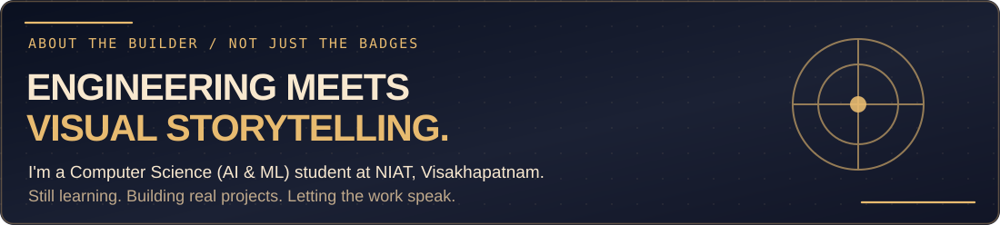

 

---

## 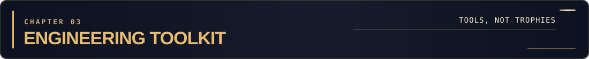

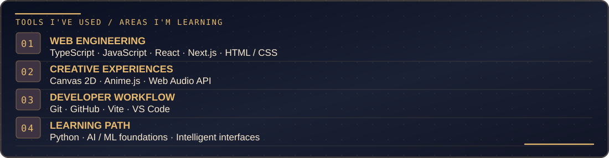

Explore the technology list as text

| Area | Technologies |
|:--|:--|
| Web engineering | TypeScript, JavaScript, React, Next.js, HTML, CSS, Tailwind CSS |
| Creative experiences | Canvas 2D, Anime.js, Web Audio API |
| Workflow | Git, GitHub, Vite, VS Code |
| Learning | Python, AI/ML foundations, intelligent interfaces |

I'm still learning; listing a technology is not a claim of expert-level proficiency.

---

## 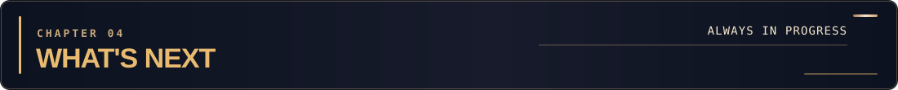

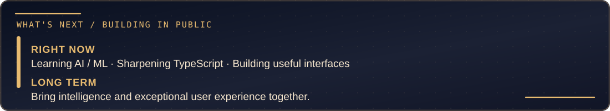

Optional GitHub activity

Stats depend on a third-party image service and may sometimes be unavailable.

---

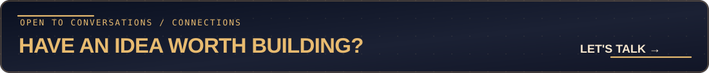

 

 

About me and this profile — readable text version

I'm **Nikhil Sai Reddy**, studying Computer Science with a focus on AI and Machine Learning at NIAT in Visakhapatnam, India. I enjoy engineering and visual storytelling, and I'm still early in my AI/ML journey.

I work with TypeScript, JavaScript, React, Next.js, Canvas 2D and animation tools, and I learn by turning ideas into useful projects. My approach is **understand, build, refine, learn**.

[Portfolio](https://nikhil-portfolio-vibex1.vercel.app) · [GitHub](https://github.com/nikhilsaireddyi) · [LinkedIn](https://www.linkedin.com/in/nikhil-sai-reddy-induri-0ab948432) · [Email](mailto:nikhilsaireddyi@gmail.com)

