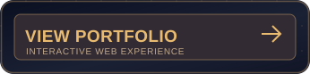
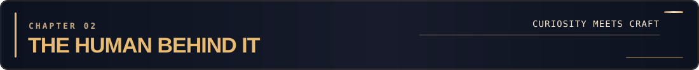
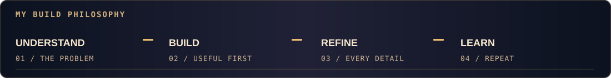

<!-- Recruiter-first GitHub profile: Midnight × Champagne Gold. All details visible; no expandable sections. -->

<picture>
  <source media="(prefers-reduced-motion: reduce)" srcset="./assets/anime-developer-avatar-still.svg" />
  
</picture>

<picture>
  <source media="(prefers-reduced-motion: reduce)" srcset="./assets/currently-building-still.svg" />
  
</picture>

 

### ✨ I turn curiosity into interactive experiences.

**Frontend Development · Creative Engineering · Learning AI/ML**

🎓 I'm a **CSE (AI & ML) student in Visakhapatnam** building interactive web experiences and exploring intelligent systems.

 

---

## 

🚀 Two public projects that show how I approach **engineering, interaction and design**.

<table>
<tr>
<td width="50%" valign="top">

<h3>🪔 <a href="https://github.com/nikhilsaireddyi/ganesh-the-quest">Ganesh: The Quest ↗</a></h3>

A story-driven browser adventure for Ganesh Chaturthi, built with a custom Canvas-based game engine.

<strong>⚙️ Engineering highlights</strong>

<ul>
<li>Scene management, input handling and camera systems</li>
<li>Procedural sound built with the Web Audio API</li>
<li>Interactive missions and festival environments</li>
</ul>

<code>JavaScript</code> <code>Canvas 2D</code> <code>Web Audio</code> <code>Vite</code>

<a href="https://github.com/nikhilsaireddyi/ganesh-the-quest"><strong>Explore the repository →</strong></a>

</td>
<td width="50%" valign="top">

<h3>💻 <a href="https://github.com/nikhilsaireddyi/Nikhil">Interactive Portfolio ↗</a></h3>

An interactive web experience combining frontend architecture with motion and creative UI.

<strong>⚙️ Engineering highlights</strong>

<ul>
<li>Component-based application architecture</li>
<li>Animation and interaction using Anime.js</li>
<li>Next.js and TypeScript frontend development</li>
</ul>

<code>Next.js</code> <code>React</code> <code>TypeScript</code> <code>Anime.js</code>

<a href="https://github.com/nikhilsaireddyi/Nikhil"><strong>Explore the repository →</strong></a>

</td>
</tr>
</table>

🔎 **Want to review the implementation?** Here are direct links to code:

- **[Game engine ↗](https://github.com/nikhilsaireddyi/ganesh-the-quest/blob/main/src/core/Engine.js)** — rendering lifecycle, input, scene orchestration and camera
- **[Procedural audio ↗](https://github.com/nikhilsaireddyi/ganesh-the-quest/blob/main/src/audio/AudioManager.js)** — sound synthesis and Web Audio controls
- **[Portfolio architecture ↗](https://github.com/nikhilsaireddyi/Nikhil/blob/main/src/app/page.tsx)** — Next.js page composition
- **[Portfolio animation ↗](https://github.com/nikhilsaireddyi/Nikhil/blob/main/src/components/sections/Hero.tsx)** — hero animation and interactions

---

## 

👋 I'm **Nikhil Sai Reddy**, studying Computer Science with a focus on **Artificial Intelligence and Machine Learning** at NIAT, Visakhapatnam.

🎨 I enjoy the intersection of **software engineering and visual storytelling**. I learn by building real projects, exploring different approaches and improving the details. I'm early in my AI/ML journey and prefer showing my work rather than overstating experience.

---

## 

| Focus | Technologies |
|:--|:--|
| 🌐 **Frontend development** | TypeScript, JavaScript, React, Next.js, HTML, CSS, Tailwind CSS |
| ✨ **Creative engineering** | Canvas 2D, Anime.js, Web Audio API |
| 🛠️ **Developer workflow** | Git, GitHub, Vite, VS Code |
| 🧠 **Learning / exploring** | Python, AI/ML fundamentals, intelligent interfaces |

These are technologies I've used or am learning; not claims of advanced expertise in every tool.

---

## 

📚 **Currently exploring:** AI/ML fundamentals, polished TypeScript experiences, and how animation can make useful interfaces more intuitive.

🎯 **Long-term goal:** Bring intelligent systems together with exceptional user experiences.

---

🤝 **Have a project idea, collaboration or opportunity? Let's connect.**

[**LinkedIn**](https://www.linkedin.com/in/nikhil-sai-reddy-induri-0ab948432) · [**Portfolio**](https://nikhil-portfolio-vibex1.vercel.app) · [**GitHub**](https://github.com/nikhilsaireddyi)

Built with curiosity · Nikhil Sai Reddy

