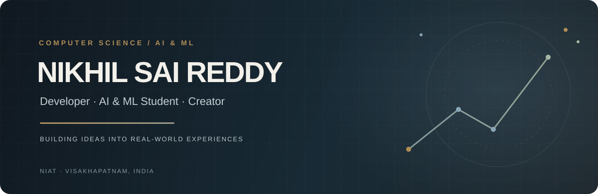
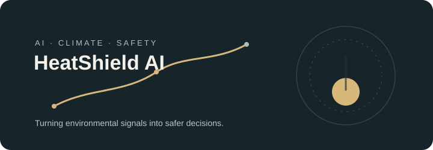

 

<a href="https://github.com/nikhilsaireddyi">GitHub</a> &nbsp;&nbsp;·&nbsp;&nbsp;
<a href="https://www.linkedin.com/in/nikhil-sai-reddy-induri-0ab948432">LinkedIn</a> &nbsp;&nbsp;·&nbsp;&nbsp;
<a href="https://nikhil-portfolio-mai54drkv-vibex1.vercel.app">Portfolio</a> &nbsp;&nbsp;·&nbsp;&nbsp;
<a href="mailto:nikhilsaireddyi@gmail.com">Email</a>

 

*I like building useful things at the intersection of software, AI, and design.*

---

## A little about me

I'm **Nikhil Sai Reddy**, a Computer Science student specializing in **Artificial Intelligence & Machine Learning** at **NIAT, Visakhapatnam**.

I learn by building: exploring an idea, shaping it into a working product, and refining the details until the experience feels right.

<table>
<tr>
<td width="50%" valign="top">

**EDUCATION**

B.Tech — CSE (AI & ML)  
NIAT, Visakhapatnam

</td>
<td width="50%" valign="top">

**WHAT INTERESTS ME**

Artificial Intelligence & LLMs  
Software engineering  
Product and interaction design

</td>
</tr>
</table>

---

## Tools I work with

<table>
<tr>
<td width="33%" valign="top">

**LANGUAGES**

</td>
<td width="34%" valign="top">

**FRAMEWORKS**

</td>
<td width="33%" valign="top">

**TOOLS**

</td>
</tr>
</table>

---

## Selected work

<table>
<tr>
<td width="50%" valign="top">

### HeatShield AI

AI · CLIMATE · WORKER SAFETY

An AI-assisted project exploring heat-risk awareness and practical worker-safety insights.

[Explore project ↗](https://github.com/nikhilsaireddyi/HeatSheild-AI-)

</td>
<td width="50%" valign="top">

### GANESH: THE QUEST

3D · GAME DEVELOPMENT · FESTIVAL

A festival-inspired 3D adventure game project focused on an interactive experience.

[Explore project ↗](https://github.com/nikhilsaireddyi/ganesh-the-quest)

</td>
</tr>
</table>

---

## What I'm focused on

- Building practical AI-powered applications
- Strengthening software architecture and engineering fundamentals
- Creating polished, intuitive digital experiences

---

**Have an interesting idea? Let's build something meaningful.**

<a href="https://www.linkedin.com/in/nikhil-sai-reddy-induri-0ab948432">Connect on LinkedIn</a> &nbsp;·&nbsp;
<a href="mailto:nikhilsaireddyi@gmail.com">Send me an email</a>

