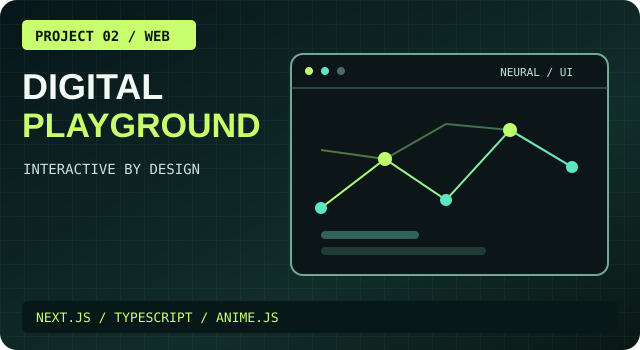

<!-- Original recruiter-first GitHub profile designed for Nikhil Sai Reddy. -->

 

<h3>I turn curiosity into interactive experiences.</h3>

I'm a <strong>CSE (AI &amp; ML) student in Visakhapatnam</strong> building expressive web interfaces and experimenting with intelligent systems.

<strong>Frontend development · Creative engineering · Learning AI/ML</strong>

 

<a href="https://nikhil-portfolio-vibex1.vercel.app"><b>↗ VISIT MY PORTFOLIO</b></a>
&nbsp;&nbsp;·&nbsp;&nbsp;
<a href="#selected-work"><b>EXPLORE MY WORK ↓</b></a>
&nbsp;&nbsp;·&nbsp;&nbsp;
<a href="mailto:nikhilsaireddyi@gmail.com"><b>LET'S CONNECT ↗</b></a>

  

---

## Selected work

REAL REPOSITORIES · REAL CODE · WORK I'M PROUD TO SHOW

<table>
<tr>
<td width="50%" valign="top">

<h3><a href="https://github.com/nikhilsaireddyi/ganesh-the-quest">Ganesh: The Quest ↗</a></h3>

A story-driven browser adventure for Ganesh Chaturthi, built around a custom 2.5D-style Canvas engine.

<strong>What I built</strong>

<ul>
<li>Scene, input and camera systems</li>
<li>Procedural audio using the Web Audio API</li>
<li>Interactive festival missions and environments</li>
</ul>

<code>JavaScript</code> <code>Canvas 2D</code> <code>Web Audio</code>

<a href="https://github.com/nikhilsaireddyi/ganesh-the-quest"><strong>Explore source code →</strong></a>

</td>
<td width="50%" valign="top">

<h3><a href="https://github.com/nikhilsaireddyi/Nikhil">Interactive Portfolio ↗</a></h3>

A digital playground where modern frontend architecture meets creative motion and interaction.

<strong>What I built</strong>

<ul>
<li>Component-based frontend architecture</li>
<li>Animation and interaction with Anime.js</li>
<li>TypeScript and Next.js-powered experience</li>
</ul>

<code>Next.js</code> <code>TypeScript</code> <code>Anime.js</code>

<a href="https://github.com/nikhilsaireddyi/Nikhil"><strong>Explore source code →</strong></a>

</td>
</tr>
</table>

<a href="https://nikhil-portfolio-vibex1.vercel.app"><strong>↗ Explore the portfolio</strong></a> &nbsp; · &nbsp; <a href="https://github.com/nikhilsaireddyi?tab=repositories"><strong>↗ Browse all public repositories</strong></a>

---

## The person behind the pixels

I'm **Nikhil Sai Reddy**, studying Computer Science with a focus on Artificial Intelligence and Machine Learning at NIAT, Visakhapatnam.

I enjoy the intersection of **engineering and visual storytelling**. A good product should work reliably, communicate clearly and feel memorable. I'm still early in my AI/ML journey, and I prefer showing the things I build over claiming skills I haven't earned.

My approach is simple:

**Understand the problem → Build the smallest useful version → Improve the details → Keep learning.**

---

## My engineering toolkit

| What I'm using | Technologies |
|:--|:--|
| **Web engineering** | TypeScript, JavaScript, React, Next.js, HTML, CSS, Tailwind CSS |
| **Creative experiences** | Canvas 2D, Anime.js, Web Audio API |
| **Build & workflow** | Git, GitHub, Vite, VS Code |
| **Learning / exploring** | Python, AI & ML fundamentals, intelligent interfaces |

Tools above reflect projects and areas I'm studying; they are not claims of advanced expertise in every technology.

### A peek under the hood

If you're reviewing my work, these are useful starting points:

- **[Game loop & scene architecture ↗](https://github.com/nikhilsaireddyi/ganesh-the-quest/blob/main/src/core/Engine.js)** — rendering lifecycle, input, scenes and camera
- **[Procedural audio engine ↗](https://github.com/nikhilsaireddyi/ganesh-the-quest/blob/main/src/audio/AudioManager.js)** — Web Audio nodes, effects and volume management
- **[Portfolio page architecture ↗](https://github.com/nikhilsaireddyi/Nikhil/blob/main/src/app/page.tsx)** — modular page composition
- **[Portfolio hero implementation ↗](https://github.com/nikhilsaireddyi/Nikhil/blob/main/src/components/sections/Hero.tsx)** — animation, reduced-motion considerations and interaction

---

## What I'm focusing on next

**Right now:** strengthening AI/ML foundations, sharpening TypeScript skills and building interfaces that are both useful and distinctive.

**Long-term direction:** connect intelligent systems with exceptional user experiences.

<b>Optional · GitHub activity snapshot</b>

 

External statistics can occasionally be unavailable; source code is the best place to evaluate my work.

---

 

<strong>Interesting idea, collaboration or opportunity? I'd love to hear about it.</strong>

<a href="mailto:nikhilsaireddyi@gmail.com">Email</a> &nbsp; · &nbsp; <a href="https://www.linkedin.com/in/nikhil-sai-reddy-induri-0ab948432">LinkedIn</a> &nbsp; · &nbsp; <a href="https://nikhil-portfolio-vibex1.vercel.app">Portfolio</a> &nbsp; · &nbsp; <a href="https://github.com/nikhilsaireddyi">GitHub</a>

 

Nikhil Sai Reddy · Building, learning, improving.

