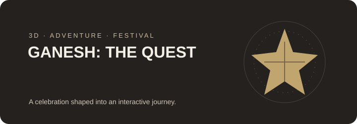

  

<a href="https://www.linkedin.com/in/nikhil-sai-reddy-induri-0ab948432">LinkedIn</a>
&nbsp;&nbsp;·&nbsp;&nbsp;
<a href="https://nikhil-portfolio-mai54drkv-vibex1.vercel.app">Portfolio</a>
&nbsp;&nbsp;·&nbsp;&nbsp;
<a href="mailto:nikhilsaireddyi@gmail.com">Email</a>

  

*Curious by nature. Building with intent.*

---

<table>
<tr>
<td width="58%" valign="top">

## The person behind the code

I'm **Nikhil Sai Reddy**, a Computer Science student focused on **Artificial Intelligence & Machine Learning** at **NIAT, Visakhapatnam**.

I enjoy taking ideas from concept to working product — combining software, AI, and thoughtful design to make digital experiences useful and intuitive.

</td>
<td width="42%" valign="top">

## At a glance

**STUDY**  
B.Tech · CSE (AI & ML)

**BASED AT**  
Visakhapatnam, India

**INTERESTS**  
AI · LLMs · Software · Product design

**APPROACH**  
Learn by building

</td>
</tr>
</table>

---

## Technology

<table>
<tr>
<td width="33%" valign="top">

**01 — LANGUAGES**

</td>
<td width="37%" valign="top">

**02 — FRAMEWORKS**

</td>
<td width="30%" valign="top">

**03 — TOOLS**

</td>
</tr>
</table>

---

## Selected work

<table>
<tr>
<td width="50%" valign="top">

### HeatShield AI

AI &nbsp;·&nbsp; CLIMATE &nbsp;·&nbsp; WORKER SAFETY

Exploring heat-risk awareness and practical worker-safety insights with AI.

[View project](https://github.com/nikhilsaireddyi/HeatSheild-AI-)

</td>
<td width="50%" valign="top">

### GANESH: THE QUEST

3D &nbsp;·&nbsp; GAME DEVELOPMENT &nbsp;·&nbsp; FESTIVAL

A festival-inspired adventure game built around an interactive experience.

[View project](https://github.com/nikhilsaireddyi/ganesh-the-quest)

</td>
</tr>
</table>

---

## What drives me

- Exploring practical applications of AI and machine learning
- Strengthening engineering fundamentals and writing better software
- Turning early concepts into thoughtful, usable products

---

### Let's make something meaningful.

Open to thoughtful conversations, learning, and collaboration.

<a href="https://www.linkedin.com/in/nikhil-sai-reddy-induri-0ab948432">Connect on LinkedIn</a>
&nbsp;&nbsp;·&nbsp;&nbsp;
<a href="mailto:nikhilsaireddyi@gmail.com">Get in touch</a>

  

© Nikhil Sai Reddy · Built with curiosity.

